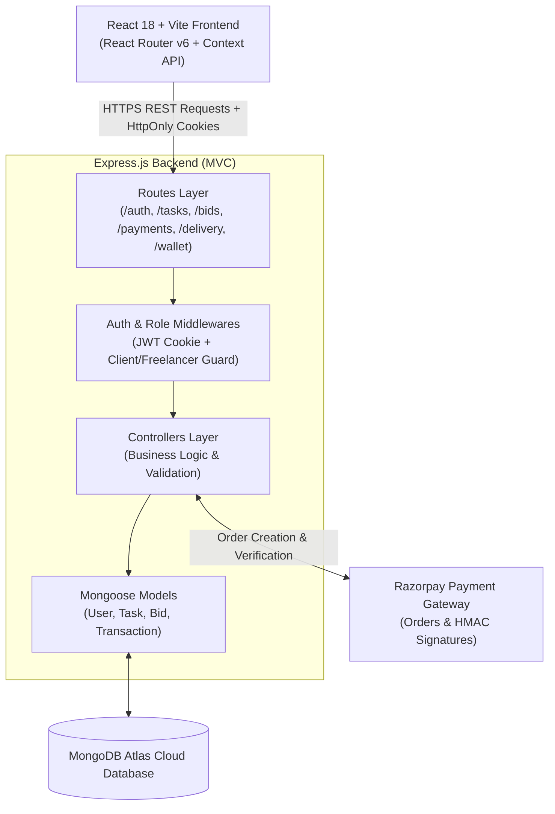

# TaskEscrow 🔒
### Campus Micro-Freelance Platform with Payment Escrow

> **End-Term Software Engineering Project — MERN Stack**  
> A full-stack web application resolving the peer-to-peer trust deadlock in campus micro-freelancing through programmatic milestone payment escrow and cryptographic verification.

---

## Final Submission Details

```text
Project Name:         TaskEscrow
Student Name:         Manav Gandass
Problem Statement:    Peer-to-peer trust deadlock in campus micro-freelancing
GitHub Repository:    https://github.com/<your-username>/TaskEscrow
Deployed Application: https://<your-app>.vercel.app
Demo Video:           https://<your-video-link>
Tech Stack:           React 18, Vite, Node.js, Express.js, MongoDB Atlas, Razorpay, JWT, bcrypt
```

---

## 1. Problem Statement

In student, college, and independent developer ecosystems, peers frequently exchange technical micro-services (such as UI design, debugging code, writing scripts, or formatting presentations). However, informal transactions suffer from an inherent **"trust deadlock"**:

1. **Client Risk:** Paying upfront via UPI risks losing money if the freelancer ghosts, delays, or produces poor-quality work.
2. **Freelancer Risk:** Delivering work before payment risks clients taking the completed files, blocking contact, and refusing compensation.

### Why Existing Solutions Fail:
Mainstream freelance platforms (Upwork, Fiverr) fail this niche completely:
* **Excessive Platform Fees:** 10%–20% commission cuts make small tasks financially unviable.
* **High Withdrawal Thresholds:** Payout minimums of \$20–\$50 and multi-day clearance delays.
* **Complex Onboarding:** Heavy KYC and tax documentation (PAN/GST/SSN) prevent casual student adoption.

---

## 2. Target Users

* **Student Clients:** Campus clubs, student founders, or classmates who need rapid, discrete tasks completed (logos, bug fixes, frontend components).
* **Student Freelancers:** Tech-savvy students looking to monetize their engineering or design skills in a safe, guaranteed environment.

---

## 3. Solution

**TaskEscrow** acts as an automated, impartial software escrow mediator:
* **Guaranteed Payment:** Clients fund tasks into a secure digital lockbox (powered by Razorpay) before work begins, assuring the freelancer that funds exist.
* **Locked Funds:** Money is safely held in programmatic escrow and cannot be withdrawn unilaterally by either party during the active task lifecycle.
* **Verified Handshake:** When the freelancer uploads their deliverable, the client reviews it and clicks **"Approve & Release"**, which instantly credits the freelancer’s in-app wallet balance.
* **Safety Nets:** If work is flawed, the client can **Request Revision**; if the freelancer misses the agreed deadline, the client can execute an automated **Refund** back to their wallet.

---

## 4. Key Features

* **Role-Based Authentication:** Dynamic role switching between Client and Freelancer with session management using secure `HttpOnly` JWT cookies.
* **Task Marketplace:** Searchable open task feed with budget indicators, deadlines, and project briefs.
* **Proposal & Bidding System:** Freelancers submit custom pitches and portfolio links; clients review all incoming proposals.
* **Razorpay Payment Escrow:** Automated checkout order generation with server-side HMAC-SHA256 signature verification and timing-safe comparison (`crypto.timingSafeEqual`).
* **Interactive Work Delivery & Review Loop:** Submission form for project links/notes with multi-state client review controls (Approve, Revision, Refund).
* **Virtual In-App Wallet & Audit Logging:** Real-time earnings balance tracking with complete transaction history (`ESCROW_LOCK`, `PAYMENT_RELEASE`, `REFUND`, `WITHDRAWAL`).

---

## 5. System Architecture

TaskEscrow adheres strictly to the **Model-View-Controller (MVC)** design pattern on the backend and a **component-driven unidirectional data-flow** architecture on the frontend.



---

## 6. The 5 Core Workflows

```text
[1. Auth & Role]      → Register as Client or Freelancer → Login (HttpOnly JWT Cookie)
         ↓
[2. Post & Bid]       → Client creates task (Budget, Deadline) → Freelancer browses & submits proposal
         ↓
[3. Escrow Locking]   → Client accepts bid → Razorpay Payment Modal → HMAC-SHA256 verified → Task IN_PROGRESS
         ↓
[4. Delivery & Review]→ Freelancer submits project link → Task UNDER_REVIEW:
                          • Approved? → Task COMPLETED, funds released to Freelancer wallet
                          • Revision? → Task reverted to IN_PROGRESS
                          • Overdue?  → Client executes REFUND back to wallet
         ↓
[5. Wallet Settlement]→ Freelancer views earnings → Initiates Withdrawal → Transaction audit log updated
```

---

## 7. Task Lifecycle State Machine

```text
OPEN  ──(bid accepted + payment verified)──▶  IN_PROGRESS
                                                    │
                              ┌─────────────────────┘
                              ▼
                        UNDER_REVIEW
                         │         │
             (approved)  │         │  (revision requested)
                         ▼         ▼
                     COMPLETED  IN_PROGRESS (loop)

OPEN  ──(client cancels)──▶  CANCELLED
IN_PROGRESS/UNDER_REVIEW + deadline passed  ──▶  REFUNDED
```

---

## 8. Technology Stack

| Layer | Technology | Engineering Purpose |
|---|---|---|
| **Frontend** | React 18, Vite | Component-driven UI, fast development with HMR |
| **Routing** | React Router DOM v6 | Single Page Application (SPA) routing with role-based route guards |
| **HTTP Client** | Axios | Network requests with global `withCredentials: true` cookie transport |
| **Backend Runtime** | Node.js (ES Modules) | High-concurrency, asynchronous event-driven JavaScript runtime |
| **Web Framework** | Express.js | MVC API structure with modular routers and error-handling middleware |
| **Database & ODM** | MongoDB Atlas, Mongoose | Cloud NoSQL persistence with schema validation, indexes, and document references |
| **Authentication** | JWT, bcrypt | Password hashing (10 salt rounds) and session signing via `HttpOnly` cookies |
| **Payment Gateway** | Razorpay SDK | Payment order creation, INR transaction handling, and HMAC-SHA256 signature verification |
| **Styling** | Custom Pure CSS | Lightweight, responsive design using CSS variables without UI library bloat |

---

## 9. Project Directory Layout

```text
MERN-End_Term/
├── .gitignore                     # Comprehensive git ignore (blocks .env, node_modules, dist)
├── README.md                      # Root documentation & architecture report
├── Server/
│   ├── config/
│   │   └── razorpay.js            # Razorpay SDK initialization
│   ├── controllers/
│   │   ├── auth.controller.js     # Register, Login, Logout, Profile
│   │   ├── bid.controller.js      # Place bid, View bids, Accept/Reject bid
│   │   ├── delivery.controller.js # Submit deliverable, Approve, Revision, Refund
│   │   ├── payment.controller.js  # Razorpay HMAC-SHA256 signature verification
│   │   ├── task.controller.js     # Task CRUD, Open feed, My tasks
│   │   └── wallet.controller.js   # Balance inquiry, Mock withdrawal, Transaction log
│   ├── middlewares/
│   │   ├── auth.middleware.js     # JWT extraction from cookie and verification
│   │   └── role.middleware.js     # requireClient & requireFreelancer guards
│   ├── models/
│   │   ├── bid.model.js           # Proposal schema (pitch, portfolio, status)
│   │   ├── task.model.js          # Task schema with 6 lifecycle states
│   │   ├── transaction.model.js   # Audit log schema for money movements
│   │   └── user.model.js          # User schema with roles and wallet balance
│   ├── routes/
│   │   ├── auth.routes.js
│   │   ├── bid.routes.js
│   │   ├── delivery.routes.js
│   │   ├── payment.routes.js
│   │   ├── task.routes.js
│   │   └── wallet.routes.js
│   ├── utils/
│   │   └── generateToken.js       # JWT signing & cross-domain cookie utility
│   ├── .env.example
│   ├── index.js                   # Express application entry point & middleware mounting
│   └── package.json
└── Client/
    ├── public/
    ├── src/
    │   ├── components/
    │   │   ├── Navbar.jsx         # Global navigation header with role-aware links
    │   │   └── ProtectedRoute.jsx # Session route guard redirecting unauthenticated users
    │   ├── context/
    │   │   └── AuthContext.jsx    # React Context provider for user session state
    │   ├── pages/
    │   │   ├── CreateTask.jsx     # Task posting form with validation (Client only)
    │   │   ├── Dashboard.jsx      # Role-based dashboard (Posted tasks vs Active tasks)
    │   │   ├── Login.jsx          # User login page
    │   │   ├── Register.jsx       # User registration page (Client / Freelancer selection)
    │   │   ├── TaskDetail.jsx     # Comprehensive task lifecycle management & Razorpay modal
    │   │   ├── TaskList.jsx       # Open task marketplace feed (Freelancer only)
    │   │   └── Wallet.jsx         # Balance card, withdrawal modal, and audit log table
    │   ├── services/
    │   │   └── api.js             # Configured Axios instance
    │   ├── App.css                # Global responsive design & status badge styles
    │   ├── App.jsx                # Route declarations & Context wrapping
    │   └── main.jsx               # Application DOM mount
    ├── vercel.json                # Single-Page Application routing rewrite rules
    ├── .env.example
    ├── vite.config.js
    └── package.json
```

---

## 10. API Reference

| Method | Endpoint | Auth Required | Role | Description |
|---|---|:---:|:---:|---|
| `POST` | `/api/auth/register` | No | Public | Register a new user (`client` or `freelancer`) |
| `POST` | `/api/auth/login` | No | Public | Authenticate user and issue `HttpOnly` JWT cookie |
| `GET` | `/api/auth/me` | Yes | Any | Return profile of currently authenticated user |
| `POST` | `/api/auth/logout` | Yes | Any | Clear session cookie |
| `POST` | `/api/tasks` | Yes | Client | Post a new task with budget and deadline |
| `GET` | `/api/tasks` | Yes | Any | Retrieve all open tasks |
| `GET` | `/api/tasks/my` | Yes | Any | Role-aware query returning user's active/posted tasks |
| `GET` | `/api/tasks/:id` | Yes | Any | Retrieve comprehensive task details |
| `DELETE` | `/api/tasks/:id` | Yes | Client | Cancel an open task |
| `POST` | `/api/bids/:taskId` | Yes | Freelancer | Submit a proposal bid on an open task |
| `GET` | `/api/bids/:taskId` | Yes | Client | Retrieve all bids for an owned task |
| `PATCH` | `/api/bids/:bidId/accept` | Yes | Client | Accept proposal and generate Razorpay escrow order |
| `PATCH` | `/api/bids/:bidId/reject` | Yes | Client | Reject proposal |
| `POST` | `/api/payments/verify` | Yes | Client | Validate HMAC-SHA256 signature and lock funds |
| `POST` | `/api/delivery/:taskId/submit` | Yes | Freelancer | Upload deliverable link and notes |
| `POST` | `/api/delivery/:taskId/approve` | Yes | Client | Approve work, complete task, and release funds |
| `POST` | `/api/delivery/:taskId/revision`| Yes | Client | Request revision and return task to progress |
| `POST` | `/api/delivery/:taskId/refund` | Yes | Client | Issue refund if agreed deadline has elapsed |
| `GET` | `/api/wallet` | Yes | Any | Fetch current wallet balance and transaction ledger |
| `POST` | `/api/wallet/withdraw` | Yes | Any | Withdraw funds from virtual wallet |

---

## 11. Security & Production Engineering

1. **Zero Raw Password Storage:** Cryptographic one-way hashing with `bcrypt` (10 salt rounds) before database persistence.
2. **XSS-Resistant Cookie Transport:** JWT tokens are stored in browser-level `HttpOnly` cookies (`SameSite: None` in production, `SameSite: Lax` in local), preventing token theft via malicious script injection.
3. **Timing-Safe Payment Signature Verification:** Cryptographic HMAC-SHA256 signatures from Razorpay are verified using Node's native `crypto.timingSafeEqual` to eliminate timing side-channel attacks.
4. **Strict Authorization & IDOR Defense:** All mutation endpoints enforce ownership checks; users cannot view bids, modify tasks, or trigger refunds for resources they do not own.
5. **No Secrets in Source Control:** `.gitignore` comprehensively ignores all `.env` files, build output (`dist/`), and dependency folders.

---

## 12. Local Development Setup

### Prerequisites
* Node.js (v18.0.0 or higher)
* MongoDB (Local instance or MongoDB Atlas connection URI)
* Razorpay Test Account (Key ID & Key Secret)

### 1. Server Configuration
```bash
cd Server
copy .env.example .env
# Edit .env and supply your MONGO_URI, RAZORPAY_KEY_ID, and RAZORPAY_KEY_SECRET
npm install
npm run dev
```
*Backend runs on `http://localhost:5001`*

### 2. Client Configuration
```bash
cd Client
copy .env.example .env
npm install
npm run dev
```
*Frontend runs on `http://localhost:5173`*

---

## 13. Deployment Guide

* **Database:** Hosted on **MongoDB Atlas** (Cloud M0 Sandbox).
* **Backend:** Deployed on **[Render.com](https://render.com)** as a Web Service. Root Directory: `Server`, Build: `npm install`, Start: `node index.js`.
* **Frontend:** Deployed on **[Vercel.com](https://vercel.com)**. Root Directory: `Client`, Build: `npm run build`, Output: `dist`. SPA rewrites configured via `Client/vercel.json`.

---

## 14. Demo Video Guidelines (3–5 Minutes)

1. **0:00 – 0:45 (Problem & Overview):** Explain the campus micro-freelancing trust deadlock and how TaskEscrow resolves it.
2. **0:45 – 2:00 (Client Posting & Freelancer Bid):** Side-by-side browser windows showing a client posting a task and a freelancer submitting a bid.
3. **2:00 – 3:15 (Payment Escrow & Delivery):** Client accepting bid, Razorpay test checkout, deliverable link submission, and client approval.
4. **3:15 – 4:00 (Wallet & Code Highlights):** Show freelancer wallet balance credit, transaction log, and briefly discuss the MVC architecture and HMAC-SHA256 verification.
